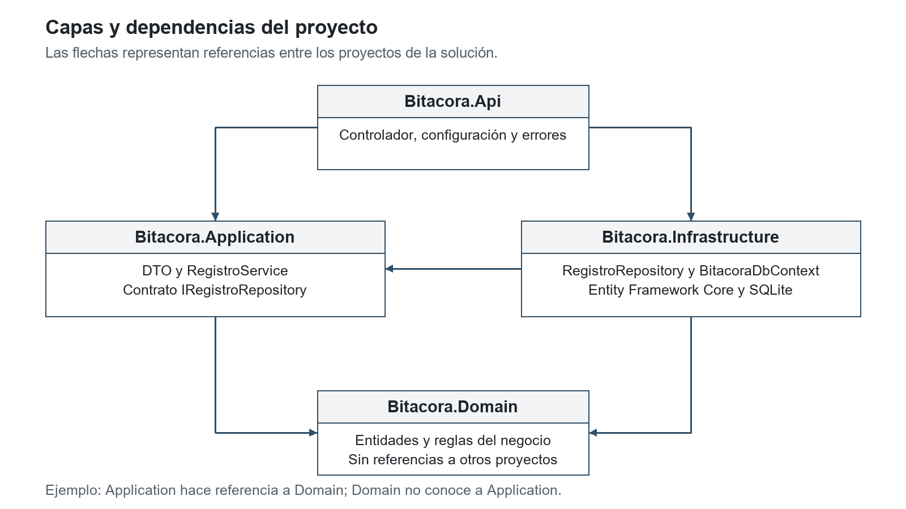
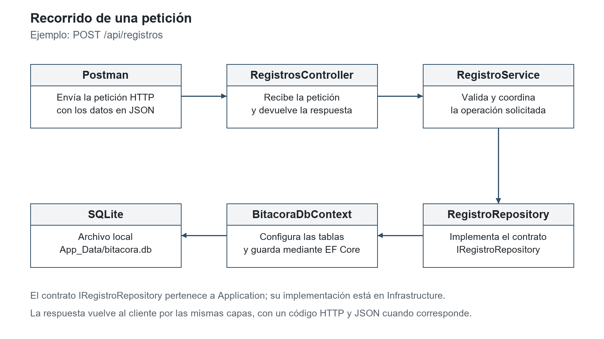
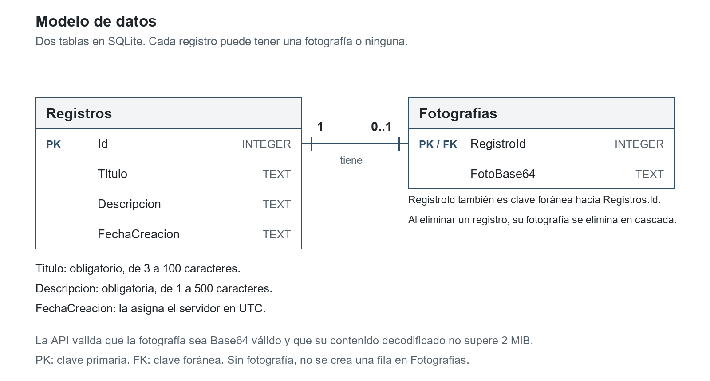
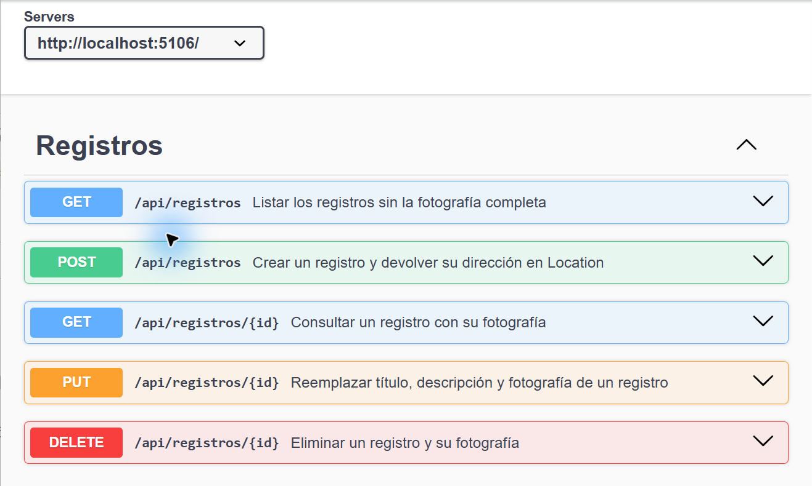
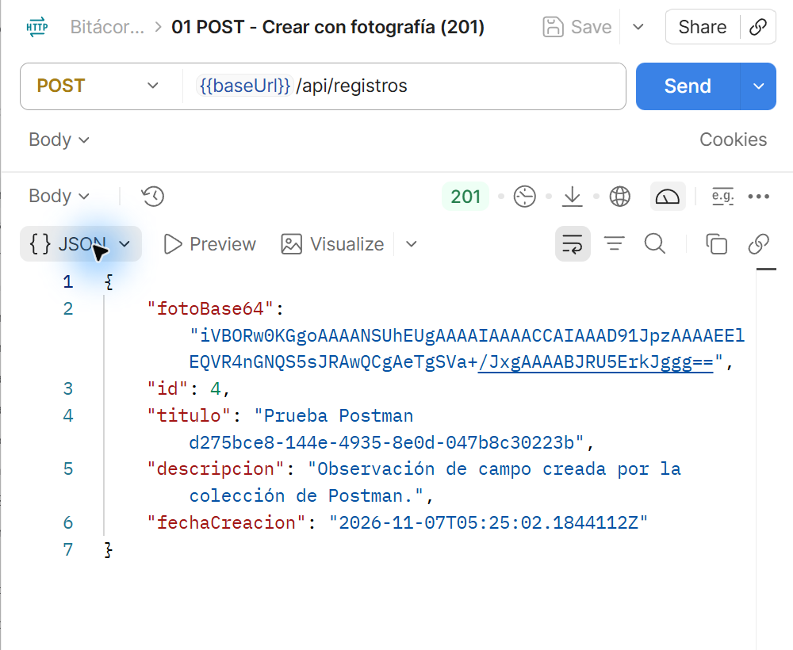
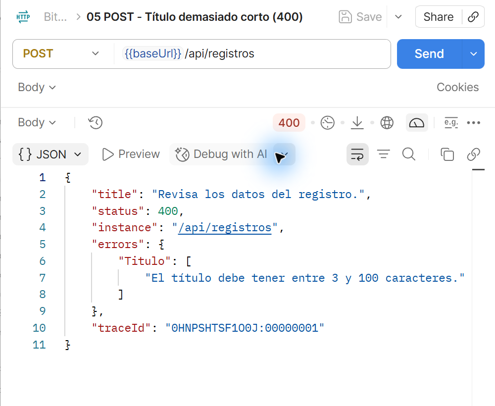
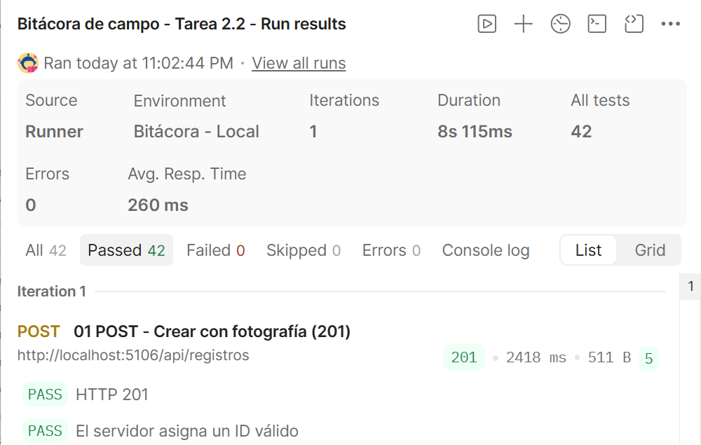

# Tarea 2.2 - API REST de la Bitácora de campo

**Grupo 04**

## Propósito del proyecto

La API permite guardar observaciones de campo con un título, una descripción y una fotografía opcional. Ofrece cinco operaciones: crear, listar, consultar por ID, actualizar y eliminar. Las pruebas se realizan en local con Postman y Swagger UI.

La solución está desarrollada en C# con ASP.NET Core y utiliza Entity Framework Core con SQLite. La aplicación Android de la tarea 2.3 utilizará estos mismos endpoints para enviar y consultar los registros.

## 1. Arquitectura y dependencias

El proyecto se divide en cuatro capas. `Bitacora.Domain` contiene las entidades y sus reglas. `Bitacora.Application` reúne los DTO, la interfaz del repositorio y el servicio que realiza los casos de uso. `Bitacora.Infrastructure` implementa el repositorio y el acceso a SQLite. `Bitacora.Api` recibe las solicitudes HTTP, configura los servicios y prepara las respuestas.

Domain no depende de ningún otro proyecto. Application depende de Domain; Infrastructure depende de Application y Domain; Api depende de Application e Infrastructure. La inyección de dependencias proporciona al servicio la implementación del repositorio.



Una petición pasa del controlador al servicio y luego al repositorio. Este utiliza `BitacoraDbContext` para acceder a la base. El servicio devuelve un DTO al controlador, que prepara la respuesta HTTP.



## 2. Datos y validaciones

La tabla `Registros` guarda el ID, título, descripción y fecha de creación. La tabla `Fotografias` guarda el Base64 y utiliza `RegistroId` como clave primaria y foránea hacia `Registros.Id`. Cada registro puede tener cero o una fotografía. El borrado del registro elimina su fotografía en cascada.



El título es obligatorio y admite entre 3 y 100 caracteres. La descripción es obligatoria y admite hasta 500. Se eliminan los espacios exteriores antes de comprobar estos límites. La foto puede omitirse; si se envía, debe ser Base64 válido, sin prefijo de data URL, y su contenido decodificado no puede superar 2 MiB (2 097 152 bytes).

El servidor asigna el ID y la fecha de creación en UTC. Una actualización conserva esa fecha. El listado devuelve los datos del registro sin la foto, mientras que la consulta por ID incluye `fotoBase64`.

Las solicitudes inválidas reciben un 400 con los campos y mensajes que deben corregirse. Para las excepciones internas hay un manejador global que registra el error y devuelve un 500 con `ProblemDetails`, sin exponer la excepción al cliente.

## 3. OpenAPI y Swagger UI

El documento OpenAPI se genera en `http://localhost:5106/openapi/v1.json`. Swagger UI está disponible en `http://localhost:5106/swagger` al ejecutar el perfil de desarrollo. Desde allí se pueden consultar los datos de entrada y las respuestas de las cinco operaciones.



| Operación | Respuesta correcta | Caso de error incluido en Postman |
| --- | --- | --- |
| GET `/api/registros` | 200, lista sin fotografía. | 406 al solicitar XML. |
| GET `/api/registros/{id}` | 200, detalle con fotografía. | 404 para un registro eliminado. |
| POST `/api/registros` | 201 con `Location`. | 400 por datos inválidos. |
| PUT `/api/registros/{id}` | 204 y cambios guardados. | 400 por datos inválidos y 404 si no existe. |
| DELETE `/api/registros/{id}` | 204 y registro eliminado. | 404 al repetir el borrado. |

## 4. Pruebas en Postman

La colección utiliza la variable `baseUrl` con el valor `http://localhost:5106`. Contiene 16 solicitudes y 42 comprobaciones. Se ejecutan en orden para utilizar el ID recibido en la creación y seguir el mismo registro durante todo el recorrido.

El primer POST envía una fotografía en Base64. Sus comprobaciones revisan el código 201, el ID, los datos devueltos, la fecha y el encabezado `Location`. Después se consulta el registro, se actualiza y se elimina. Las consultas y borrados posteriores deben responder 404.



Los casos de validación incluyen título demasiado corto, descripción de 501 caracteres, Base64 inválido y fotografía mayor de 2 MiB. La respuesta debe indicar qué dato se debe corregir.



En el Runner, una respuesta 400, 404 o 406 puede ser correcta: cada prueba comprueba el código que corresponde a su caso. El resumen permite revisar cuántas comprobaciones aprobaron y si hubo fallos.



La colección elimina el registro que creó durante la prueba. Si se interrumpe antes del DELETE, ese registro puede permanecer en la base. Las instrucciones completas y el resultado de la ejecución se encuentran en el [README](../README.md) y en [los resultados de Postman](../postman/RESULTADOS.md).

## 5. Ejecución local

Se requiere .NET SDK 10. Desde la carpeta que contiene `Bitacora.sln` se ejecutan estos comandos:

```cmd
dotnet restore Bitacora.sln
dotnet tool restore
dotnet ef database update --project src\Bitacora.Infrastructure --startup-project src\Bitacora.Api
dotnet run --project src\Bitacora.Api --launch-profile http
```

Las migraciones crean o actualizan `src/Bitacora.Api/App_Data/bitacora.db`. SQLite no necesita un servidor aparte. La ventana de la API debe permanecer abierta mientras se utiliza Swagger o Postman.

## 6. Integrantes y responsabilidades de revisión y cierre

| Integrante | Número de cuenta | Revisión asignada |
| --- | --- | --- |
| Hector Josue Nuñez Perdomo | 202320120070 | Entidades del dominio y validaciones del registro. |
| Jesus Andres Herrera Velasquez | 202010010221 | DTO y servicio de Application; recorrido de los casos de uso. |
| Bessy Maribel Delcid Ruiz | 202130120003 | Configuración de EF Core, SQLite y aplicación de migraciones. |
| Bellymar Celeste Amaya Andino | 201820010372 | Controlador, respuestas HTTP, manejo de errores y Swagger. |
| Marlon Jared Saenz Blanco | 202230010131 | Colección de Postman, encabezados y revisión de resultados. |
| Luis Eduardo Sagastume Rodríguez | 201910040199 | Documentación, diagramas y guía de ejecución local. |

Cada integrante revisará la parte asignada y registrará sus cambios en GitHub antes de la entrega.

## 7. Archivos de entrega

Se incluyen el código de los cuatro proyectos, las migraciones, el README, la colección y el entorno de Postman, las capturas y este informe en PDF. La publicación en GitHub se realizará al final; el enlace se añadirá cuando el repositorio esté disponible. Cada integrante deberá registrar sus aportes reales y poder explicar el recorrido de una petición.
